# npm-install-audit

npm-install-audit looks at what `npm install` will execute and fetch before you run it. It reads `package.json` and the lockfile and reports lifecycle scripts that download or evaluate code, dependencies pulled from git or a URL instead of the registry, wildcard versions that accept anything, tarballs resolved over plain HTTP and a missing lockfile. It has no dependencies, so reviewing a project does not require installing one.



**Live demo:** https://jvch0512.github.io/npm-install-audit/ (Synthetic manifests.)

Node.js 18+, no dependencies. The demo page is rendered from the tool's `--tsv` output by `scripts/site.py` (Python 3, only needed to regenerate the page).

## Use

```bash
bin/npm-install-audit examples
bin/npm-install-audit ./my-app --tsv
bin/npm-install-audit package.json --fail-on high       # exit 1 on any high finding
```

A directory is scanned recursively for `package.json`, `package-lock.json` and `npm-shrinkwrap.json`. `node_modules` and `.git` are skipped.

| Rule | Severity | What it catches |
|---|---|---|
| NPM001 | high | a `preinstall`, `install`, `postinstall` or `prepare` script that downloads and runs code, evaluates strings (`node -e`, `eval`), decodes base64, runs PowerShell or opens a reverse-shell style socket |
| NPM002 | medium or low | any install lifecycle script: medium for `preinstall`, `install` and `postinstall`, low for `prepare` |
| NPM003 | high | a dependency taken from git, a GitHub shorthand or a URL tarball instead of the registry |
| NPM004 | medium | a wildcard version: `*`, `latest`, `x`, an empty string or `>=0` |
| NPM005 | low | a `file:` or `link:` dependency |
| NPM006 | high | a lockfile entry resolved over plain `http://` |
| NPM007 | medium | an install script that uses `sudo` or `--unsafe-perm` |
| NPM008 | low | a manifest with dependencies and no lockfile next to it |
| NPM009 | low | a lockfile entry with a `resolved` URL and no `integrity` hash |
| NPM000 | info | the file is not valid JSON |

See [examples](examples) and [docs/sample-output.txt](docs/sample-output.txt).

## Limits

- It does not query the registry, so it cannot tell whether a package name is a typosquat, deprecated or known to be vulnerable. Use `npm audit` for advisories.
- Lifecycle scripts of dependencies are not read, because they are not in `package.json` of the project. Run `npm install --ignore-scripts` when you review unknown code.
- Script checks are text patterns. A script that builds its command at run time is not caught.
- Yarn and pnpm lockfiles are not parsed. They count as a lockfile for NPM008.

## Where it fits

Supply-chain reviews of a repository before the first install, and a CI gate on pull requests that touch package.json.

## Tests

```bash
make test    # node:test suites: every rule on good and bad manifests and lockfiles, version-spec classification, lockfile v1 to v3, hostile input, 3000-case fuzzing and CLI exit codes
```

MIT.

## Code scanning (SARIF)

`scripts/tsv2sarif.py` converts the `--tsv` output into SARIF 2.1.0, so findings show up in GitHub code scanning:

```sh
bin/npm-install-audit examples --tsv | python3 scripts/tsv2sarif.py --tool npm-install-audit --prefix examples > results.sarif
```

Upload `results.sarif` with `github/codeql-action/upload-sarif`. Severities map to SARIF levels (critical and high to error, medium to warning, low and info to note) and to a `security-severity` score.
